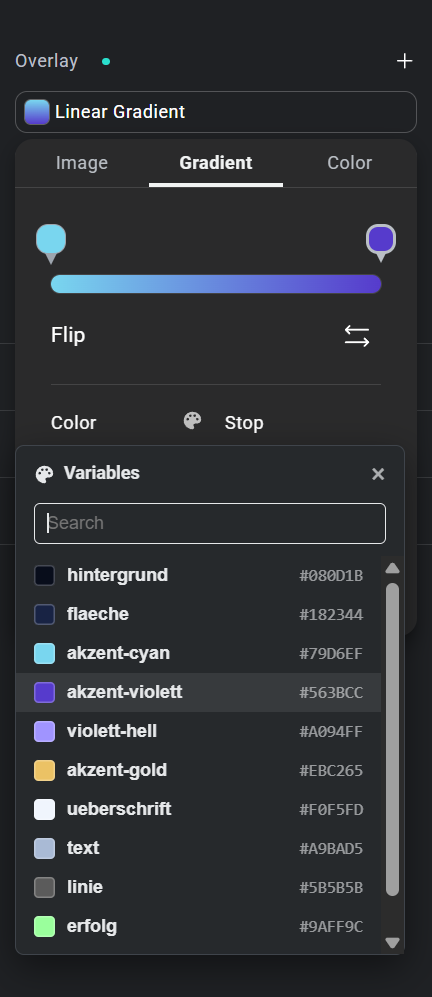

# NoviFix

Use your global color variables in Elementor background gradients.

In the Elementor editor (Editor V4), every color field offers your color variables, except one: the color stops of a background gradient. There you only get the manual color picker, so you end up looking up hex values again and again. Elementor knows about it ([discussion #32289](https://github.com/orgs/elementor/discussions/32289)), but there is no date for a fix yet.

NoviFix closes that gap until Elementor does.

## How it works

1. Open a background overlay and switch to **Gradient**.
2. Click a color stop marker on the gradient bar.
3. Click the palette icon next to **Color**.
4. Pick a variable from the list, or search for it.

The selected color stop gets the color of that variable.

## Good to know

- The list shows the color variables of your active kit, in the same order as the Variables Manager.
- The color stop stores the color value. If you change a variable later, existing gradients keep their color.
- New variables show up after reloading the editor.
- NoviFix does not change Elementor. It only adds the button in the editor and loads nothing on your site's frontend.
- This is a temporary fix. Once Elementor supports variables in gradient controls, you can simply remove NoviFix.

## Requirements

- WordPress 6.5 or newer
- PHP 7.4 or newer
- Elementor with Editor V4 (tested with Elementor 4.3)

## Installation

1. Download NoviFix at [novissium.com/resources/novifix](https://www.novissium.com/resources/novifix/).
2. In WordPress, go to **Plugins → Add New Plugin → Upload Plugin**.
3. Upload the ZIP file and activate **NoviFix**.

## License

GPL-2.0-or-later. See [LICENSE](LICENSE).

NoviFix is not affiliated with or endorsed by Elementor.

Made by [Novissium](https://www.novissium.com/resources/novifix/).
